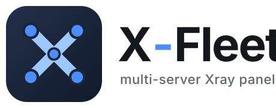

**English** | [العربية](README.ar.md) | [فارسی](README.fa.md) | [中文](README.zh.md) | [Español](README.es.md) | [Русский](README.md) | [Türkçe](README.tr.md)

<p align="center">
  <picture>
    <source media="(prefers-color-scheme: dark)" srcset="media/logo-dark.svg">
    
  </picture>
</p>

# X-Fleet — installation

This repository holds ready-made X-Fleet releases (the **Releases** tab): the Linux program (amd64, arm64),
the `install.sh` installer and `SHA256SUMS` checksums. Below is how to install it.

X-Fleet is a panel for managing an Xray VPN on many servers at once. It installs with a single command,
with no Docker and no separate database.

> The installer and the panel interface are available in **English** and **Russian**.

## Requirements

- A server (VPS) with **Ubuntu 22.04+** or **Debian 12+**, amd64 or arm64 CPU.
- **root** access over SSH.
- Preferably your own domain (for example `panel.example.com`) with an A record pointing to the server IP.
  A domain is optional: without one the panel uses a free name like `1-2-3-4.sslip.io`.
- Open ports at your hosting provider (in its control panel, if it has its own firewall):

| Port | Purpose |
|---|---|
| 80 | Let's Encrypt checks the domain to issue a certificate |
| random (shown by the installer) | panel login |
| 8444 | nodes connect to the panel |
| 2096 | subscription links for clients |
| 443 and 8443 | the VPN itself (if this server also serves VPN) |

If `ufw` is enabled on the server, the installer opens the required ports in it automatically.

## 1. Installing the panel

Log in to the server as root and run:

```bash
bash <(curl -fsSL https://github.com/richdodcom-pixel/x-fleet-releases/releases/latest/download/install.sh)
```

An installation wizard opens and asks questions step by step. If unsure, press Enter: it selects the default option.

1. **Language:** Russian or English.
2. **System check and packages.** The installer offers to update the system (`apt upgrade`).
   On a server that already runs something, you can decline.
3. **Address and HTTPS.** Enter your domain or choose the no-domain option (sslip.io).
   The panel obtains a Let's Encrypt certificate by itself.
4. **Panel settings.** The port, secret path and login are chosen randomly; the password is generated.
5. **VPN on this server.** You can make this server the first node right away:
   - VLESS Reality XHTTP on port 443 (main connection);
   - TCP + Vision on port 8443 (backup).

   Here you also choose the camouflage website and create the first user.
6. **Start and check.** Services start and come back up automatically after a reboot.

At the end the screen shows the **panel address, login and password**, plus the first user's subscription QR code.
The login details are saved to `/root/x-fleet-admin.txt`. To see them again:

```bash
cat /root/x-fleet-admin.txt
```

### Non-interactive installation

Add `--yes` and everything is set to defaults. Other options can be passed right away:

```bash
bash <(curl -fsSL https://github.com/richdodcom-pixel/x-fleet-releases/releases/latest/download/install.sh) --yes --domain panel.example.com
```

| Option | What it does |
|---|---|
| `--lang ru\|en` | language of the installer and menu |
| `--domain panel.example.com` | your own domain for the panel and subscriptions |
| `--https le\|ip\|self\|none` | HTTPS: own domain / no domain (sslip.io) / self-signed / no HTTPS (SSH tunnel only) |
| `--cert file --key file` | your own certificate instead of Let's Encrypt |
| `--email you@example.com` | email for Let's Encrypt notices |
| `--port 31234` | panel port (random by default) |
| `--login name` | administrator login (random by default) |
| `--connections rec\|xhttp\|vision\|none` | VPN on this server: both connections / XHTTP only / Vision only / none |
| `--mask neighbor\|self\|<site>` | Reality camouflage: a neighbour site in the same subnet / your own site on the server / the given site |
| `--user name` | first user (default `user`) |
| `--name name` | server name in client apps, Latin letters |
| `--upgrade` / `--no-upgrade` | update the system or not |
| `--bbr` / `--no-bbr` | enable TCP acceleration (BBR) or not; enabled by default |
| `--version v0.7.1` | install a specific version |

Full option reference:

```bash
bash <(curl -fsSL https://github.com/richdodcom-pixel/x-fleet-releases/releases/latest/download/install.sh) --help
```

## 2. First login

1. Open the address shown by the installer in a browser, for example
   `https://panel.example.com:31234/AbCdEf123/`.
   The address is secret: without the correct path the panel does not open, and scanners cannot find it.
2. Log in with the login and password from `/root/x-fleet-admin.txt`.
3. We recommend right away:
   - **Settings → Security**: change the password and enable two-factor sign-in;
   - **Settings → Notifications**: connect Telegram to learn about failures;
   - **Settings → System**: enable scheduled backups.

## 3. Adding nodes (other VPN servers)

A **node** is a server through which clients connect to the VPN. The panel manages nodes remotely.
Each new node needs an **install command**. The panel itself issues it; it is not on GitHub:
the command contains the address of your panel and a one-time key.

### Step 1. Get the command in the panel

1. Open the panel in a browser and log in.
2. In the left menu choose **Nodes**.
3. Click the blue **Add node** button (top right).
4. Fill in the form:

   | Field | What to enter |
   |---|---|
   | **Name** | any clear name in Latin letters, for example `amsterdam-1` |
   | **Address (IP or domain)** | the new server's IP, for example `203.0.113.10`. Clients see it in the subscription |
   | **Node domain (for camouflage)** | may be left empty. If you have a domain with an A record to this server's IP, enter it, for example `nl1.example.com` |
   | **Country** and **City** | may be left empty: the panel detects them from the IP. Clients will see, for example, `🇳🇱 Netherlands, Amsterdam` |
   | **Add inbounds from templates right away** | leave it ticked: connections on the node are created automatically |

5. Click **Create**.
6. The **Install node** window opens with a long command. It starts with `curl -fsSL https://…/node.sh | bash -s -- …`.
   Click the **copy** icon to the right of the command.

The command looks roughly like this (your address, token and fingerprint will differ):

```text
curl -fsSL https://panel.example.com:2096/install/Ab12Cd/node.sh | bash -s -- --panel panel.example.com:8444 --token 7f3a… --pin 9c1e…
```

> **Important:** the command is single-use and valid for **15 minutes** (the expiry time is shown in the window).
> Missed it or closed the window? Open **Nodes** → click the node → **New install token**,
> and a fresh command appears.

**Another way — from the panel server.** SSH into the server where the panel is installed and run:

```bash
x-fleet node-cmd
```

The program asks for the node name, its IP and domain (Enter — no domain) and prints a ready command. It is valid for 30 minutes.

### Step 2. Run the command on the new server

1. SSH into the **new server** (the future node, not the panel server) as root:
   ```bash
   ssh root@203.0.113.10
   ```
2. Paste the copied command (in a terminal: right click, or Ctrl+Shift+V / Cmd+V) and press Enter.
3. Wait 1–2 minutes. The node will:
   - download the program from your panel and verify its checksum;
   - connect to the panel over a secure channel;
   - download and start Xray.

### Step 3. Check

Go back to the panel → **Nodes**. In a few seconds the new node shows a green status.
Connections from templates are already created. The node appears in the subscriptions of users in its squad
(the **Squads** section). The subscription link does not need to change: the app picks up the new server when it refreshes the subscription.

### If it did not work

- **"install token expired":** get a new command: node page → **New install token**.
- **The node does not connect to the panel:** port **8444** must be open on the panel server
  (and **2096**, the program is downloaded from it). Check your provider's firewall.
- **Another VPN already runs on the new server** (for example 3x-ui) and ports 443/8443 are taken: the installer stops
  and shows which program holds the port. This way the old VPN does not break. Free the ports or set different
  ports for this node in the panel.
- **The node is the panel server itself:** nothing to install, the panel installation wizard offers this right away (the "VPN on this server" step).

## 4. Users and subscriptions

**Users** → **New user**. Every user has a subscription link that is added to an app.
The subscription page shows a QR code and buttons for apps.

### Client apps

| App | How to add the subscription |
|---|---|
| **NOX** (recommended, Android 7+) | [download NOX.apk](https://github.com/richdodcom-pixel/nox-updates/releases/latest/download/NOX.apk). The **NOX** button on the subscription page opens the app and adds the subscription |
| Happ, Hiddify, INCY, v2RayTun, Streisand, v2rayNG, Clash Verge / FlClash | the app's button on the subscription page (or paste the subscription link into the app) |
| sing-box and other Clash / Mihomo clients | paste the subscription link — the panel serves the right format automatically |

## Server management: the `x-fleet` command

Type `x-fleet` on the server to open the menu. Quick commands:

| Command | What it does |
|---|---|
| `x-fleet url` | show the panel address and login |
| `x-fleet password` | new administrator password |
| `x-fleet 2fa off` | turn off two-factor sign-in (if you lost your phone) |
| `x-fleet status` | service status |
| `x-fleet restart` | restart services |
| `x-fleet log` | log |
| `x-fleet port 31234` | change the panel port |
| `x-fleet path` | new secret panel path |
| `x-fleet https` | panel certificate |
| `x-fleet update` | update X-Fleet |
| `x-fleet backup` | back up now |
| `x-fleet check` | server check |
| `x-fleet link name` | a user's subscription link with a QR code |
| `x-fleet node-cmd` | install command for a new node |

## Updating

- **Panel:** **Settings → System → Panel update**. Or on the server: `x-fleet update`.
  The previous version is kept for rollback.
- **Nodes:** **Settings → Cores**: update Xray and agents on all nodes at once.
  Or one by one on the node page. **Settings → System → Update all servers** updates every node in one click.

## Changing the panel address or domain

**Settings → Network & certificates**. Here you change the port, the secret path and the certificate
(your own domain, sslip.io or self-signed).

- The panel obtains a certificate for the new domain **before** switching. If Let's Encrypt refuses, nothing changes,
  and the reason is shown on screen.
- After the change, open the panel at the new address and log in **within 10 minutes**. Otherwise the previous settings return automatically,
  and you do not lose access.

## Troubleshooting

- **The certificate is not issued:**
  - check that the domain's A record points to the server IP, and in Cloudflare the cloud is grey (DNS only);
  - check that port 80 is open at your provider;
  - Let's Encrypt issues at most 5 certificates per name per week. If you reinstall often, wait
    or temporarily choose the no-domain option (sslip.io).
- **Forgot the address or password:** log in to the server and run `x-fleet url` or `x-fleet password`.
- **General check:** `x-fleet check`.

## Uninstalling

```bash
x-fleet uninstall
```

The command stops the services and removes the program, settings and data. Backups stay in `/var/lib/x-fleet/backups`.

---

## Upgrading from old versions (nodepanel)

Before v0.5.0 the program was called `nodepanel`. When updating with the button, everything moves to the new names by itself:

| Was | Now |
|---|---|
| `/usr/local/bin/nodepanel` | `/usr/local/bin/x-fleet` (the old name stays as a link) |
| services `nodepanel-panel`, `nodepanel-node` | `x-fleet-panel`, `x-fleet-node` |
| `/etc/nodepanel`, `/var/lib/nodepanel`, `/var/lib/nodepanel-node` | `/etc/x-fleet`, `/var/lib/x-fleet`, `/var/lib/x-fleet-node` |
| `/root/nodepanel-admin.txt` | `/root/x-fleet-admin.txt` |

If the new service does not start, everything returns as it was. To repeat manually run `x-fleet migrate`;
the migration log: `journalctl -u x-fleet-migrate`.

## Support the project

X-Fleet is free and built by a single developer in their spare time. If the panel is useful to you,
you can support its development with any amount. It is voluntary: every feature works without payment.

| Coin | Network | Address |
|---|---|---|
| USDT | **TRON (TRC20)** | `TYWjc2oNwm32wcQUX5cDjQ2vWCCLuS1vkH` |
| TON | **TON** | `UQB6Fryf-lEQXMGQlOIdHu5QTk_lcOgeKL0m424k92hbiWhw` |

> ⚠️ Send coins only on the stated network — transfers from other networks will be lost.
> QR codes for these addresses are in the panel itself: the **Support** item in the menu.

Thank you! 💙
